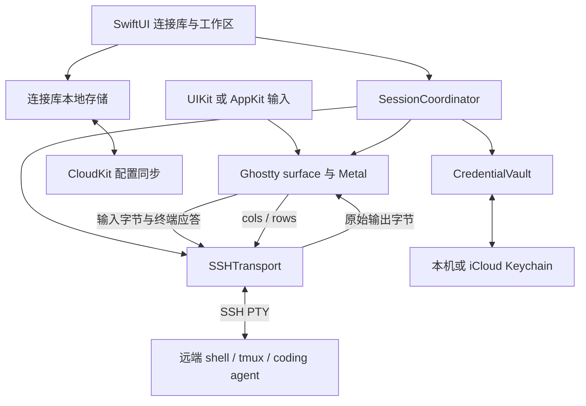

# pocahontas 产品与终端架构

设计日期：2026-10-25。本文定义首版建议方案和实施验收条件；具体依赖版本需通过集成验证后锁定。

pocahontas 是面向 coding agent 的原生终端客户端。首版让用户在 iPhone / iPad 上连接自己的开发机器，使用完整 TUI，离开 App 后让任务继续在远端运行，回来时接回原会话。后续 macOS 共享连接库和核心逻辑，使用原生桌面界面。

建议采用 **Ghostty 完整渲染层 + madeye passthru IO + SSH + 远端 tmux**。SSH 配置和凭据在产品中属于同一个连接库，分别由 CloudKit 和 iCloud Keychain 同步，详见 [SSH 同步设计](ssh-sync.md)。首版不需要自建账号或同步服务器。

## 首版体验

主要入口是「连接」「工作区」「身份与设置」。连接保存主机、端口、用户名和认证方式；工作区关联主机、远端目录、tmux session 与可选启动命令；身份集中管理私钥，多个主机可以引用同一个身份。

首版应包含：

- SSH 交互终端、密码与 Ed25519 公钥认证、主机指纹校验。
- 中文输入法、外接键盘、Esc / Tab / Ctrl / Alt / 方向键、文本选择、复制与 bracketed paste。
- 少量并行会话与会话切换；iPad 侧栏；字体大小。App 与终端固定浅色外观，不提供深浅色切换。
- 可选的 tmux 持久工作区，以及断线、返回前台后的重新连接。
- 本地保存连接库；用户开启 iCloud 后同步配置，并逐项选择是否同步凭据。

新建工作区时，用户可以指定 agent 启动命令。命令仅在明确启动时执行；重新连接不会再次启动 agent。首版展示连接状态与终端内容，不通过屏幕文字猜测「agent 已完成」或「等待审批」。可靠任务状态与后台通知需要远端 hooks / 服务支持，放在后续版本。

首版范围之外：自建 agent 编排平台、强制安装远端 daemon、Mosh、完整 SFTP UI、端口转发 UI、团队共享保险库、macOS 本地 shell。普通 SSH 模式不依赖 tmux，但不承诺断线后恢复原进程。tmux 模式要求用户的服务器已安装 tmux；不自动安装远端软件。

## 从 baxian 吸取的经验

已核对 baxian-app-ios 远端 `83217070ecde7255eaff1aed0da5f84c16d5e8de`；本机副本停在 `1e6ce880bc126ff91b8ca83192c0d994e2e52338`，另外检查了两者之间的改动，包含字号与隐私遮罩修正。其 Ghostty submodule 锁在 `e9ad2064a8e110f5d529d0ba1999ccf0bdfc6d57`。

| 已有实现或经验 | pocahontas 的采用方式 |
| --- | --- |
| `GhosttyEngine` 统一持有 app 与帧驱动 | iOS 使用进程级 engine；多个 surface 不各建一套 display link；不可见或后台停止无效绘制。 |
| Ghostty 自己添加 Metal sublayer | 保留普通 UIView 容器，布局时同步渲染层 frame、scale 和像素尺寸，避免零尺寸黑屏。 |
| `TerminalTextInputView` 处理 marked text | 组合阶段不发送拼音、不把候选区删除转换为远端退格，提交后的文本只发送一次。 |
| C 回调可能来自引擎线程 | 立即复制 callback 字节；依照实际线程契约切到串行 IO / MainActor；明确 userdata 生命周期。 |
| 单次 Ctrl / Alt 与外接键盘处理 | 复用交互与测试契约；组合输入期间仍由输入法处理按键。 |
| 字号预览曾与真实终端不一致 | UI 单位保持 UIKit points；锁定引擎下核对 DPI 换算和字形尺寸，不把旧版换算常量当永久规则。 |
| XCFramework 三平台切片验证 | 校验 macOS、iOS device、iOS simulator 的架构和 Mach-O platform，缓存命中后也验证。 |
| 隐私遮罩与生命周期测试 | App 切换快照遮盖终端内容；测试激活、失焦、后台、返回和释放。 |

依据：[终端源码](https://github.com/rockdai/baxian-app-ios/tree/83217070ecde7255eaff1aed0da5f84c16d5e8de/Baxian/Terminal)、[Ghostty 包装](https://github.com/rockdai/baxian-app-ios/tree/83217070ecde7255eaff1aed0da5f84c16d5e8de/Baxian/Ghostty)、[回归测试](https://github.com/rockdai/baxian-app-ios/tree/83217070ecde7255eaff1aed0da5f84c16d5e8de/BaxianAppTests)、[构建验证脚本](https://github.com/rockdai/baxian-app-ios/blob/83217070ecde7255eaff1aed0da5f84c16d5e8de/scripts/verify-ghostty-xcframework.sh)。

以下部分必须按 SSH 场景重新实现：

1. **终端自动应答保持开启。** baxian 的服务端已有终端处理，客户端通过 `pty_suppress_replies = true` 避免重复应答。SSH 直连时本地 Ghostty 就是终端，DA、DSR、CPR、颜色和键盘协议查询等回复必须经 SSH 返回。madeye 的 passthru 默认转发这些输出；使用 baxian fork 时必须关闭 suppression。
2. **全链路传递 bytes。** baxian 的 WebSocket 输入路径转换为 UTF-8 String；SSH 层必须保留 Data / ByteBuffer，不把任意分片先解码成 String，以免丢失跨包 UTF-8、控制序列或其他字节。
3. **不引入 baxian 的 snapshot / seq 协议。** SSH 重连建立新 channel，tmux 重新绘制；不需要复制服务端 xterm snapshot、临时 grid 与序号恢复机制。
4. **会话生命周期独立于 SwiftUI view。** baxian 按激活状态创建或销毁 surface 的做法不能直接套到多会话 SSH。切换 tab 不关闭连接；存活会话保留解析状态，暂停不必要绘制。销毁后通过 tmux 重建，不声称有完整本地回放。
5. **认证模型重新设计。** baxian 的单服务 URL + token Keychain 封装不覆盖多个 SSH 身份、host key trust 或跨设备同步。

## Ghostty 集成路线

Ghostty 官方当前的 `include/ghostty.h` 明确将完整 surface API 标为内部 embedder API，并推荐外部集成使用 `libghostty-vt`。后者提供终端状态与解析能力，不能直接等同于 baxian 使用的 UIKit / Metal 完整集成。官方存在可嵌入库，不代表完整 surface API 已稳定，也不代表已具备这里需要的远程 IO 后端。[官方头文件](https://github.com/ghostty-org/ghostty/blob/cec8b92f1ecd176a20a56aa405021e7ae991b996/include/ghostty.h)

madeye fork 提供 `GHOSTTY_IO_BACKEND_PASSTHRU`、`ghostty_surface_pty_data`、`pty_write_cb` 和 `pty_resize_cb`，宿主负责传输，Ghostty 负责终端。gterm 提供了这条路线与 SwiftNIO SSH 的 iOS 集成案例。[madeye 头文件](https://github.com/madeye/ghostty/blob/7fb9e90363a431d15a67a22ff661e33c1be59060/include/ghostty.h)、[gterm](https://github.com/madeye/gterm/tree/c17c46acf79e0c30affa4b60540a9b9c39a562c5)

实施选择：

- 以 madeye `7fb9e90363a431d15a67a22ff661e33c1be59060` 为第一个集成候选，复用 baxian 的 Swift 包装经验。只有发现所需修复时才携带额外 patch；不因复用而默认加入 baxian 专属 reply suppression。
- submodule / 构建清单锁定完整 commit，Swift 包装与头文件一起升级。该候选是验证起点，距离当前 upstream 已有差距，不能把它当作已完成安全与兼容验证的发布版本。
- 对比 upstream 的修复并维护最小 patch 集；上游完整 surface IO 能力满足需求后再考虑移除 fork。首版不自行重写 Metal renderer。
- 发布构建记录引擎 SHA、补丁摘要、Zig 精确版本、Xcode / SDK 版本、构建参数和产物校验和。构建产物不直接提交源码仓库。

baxian / gterm 曾处理 libxev 的 iOS mach-port 支持，以及 Zig 与特定 Xcode SDK 的兼容问题。gterm 后续脚本还有 SDK 头文件兼容补丁，因此不能假设旧脚本能在当前工具链直接成功。迁移时把必要补丁放进项目控制的源码或隔离工具链，不照搬对全局 Zig 安装和共享缓存的修改。[baxian 构建脚本](https://github.com/rockdai/baxian-app-ios/blob/83217070ecde7255eaff1aed0da5f84c16d5e8de/scripts/build-ghostty-xcframework.sh)、[gterm 构建脚本](https://github.com/madeye/gterm/blob/c17c46acf79e0c30affa4b60540a9b9c39a562c5/scripts/build-ghostty-xcframework.sh)

## 模块与数据流

建议使用 Swift 6，最低 iOS / iPadOS 17，后续 macOS 14。这与 `CKSyncEngine` 的平台基线一致。共享代码使用 Swift Package；iOS SwiftUI + UIKit，macOS SwiftUI + AppKit，平台 view 不强求共用。[Apple 同步示例](https://github.com/apple/sample-cloudkit-sync-engine)



建议目录如下。起步仅建一个共享 package，按目录组织，不为每个类型建立独立 package。

```text
Apps/iOS/                    SwiftUI 页面、UIKit terminal host、应用生命周期
Apps/macOS/                  后续桌面 target
Packages/PocahontasKit/
  Sources/PocahontasKit/
    Connections/             HostProfile、SSHIdentity、WorkspaceBookmark
    Credentials/             Keychain 存取与认证材料解析
    SSH/                     transport、host key 校验、认证与 PTY
    Sessions/                会话状态与 tmux 工作区
    Persistence/             本地存储与迁移
    Sync/                    CloudKit 映射与冲突处理
  Tests/
Terminal/Ghostty/            隔离 C ABI 的薄 Swift adapter
Terminal/iOS/                输入法、手势、键盘和渲染层宿主
Terminal/macOS/              后续 AppKit adapter
vendor/ghostty/              固定版本的引擎
scripts/                     构建、切片验证与集成测试入口
```

纯模型、状态与协议逻辑可在 macOS 离线测试；Security / CloudKit 适配器另有平台集成测试。无需为了测试把所有类型都抽象成协议；只在 SSH transport、凭据存取、持久化和同步这几个有替换需求的边界隔离。

## SSH 连接与恢复

优先验证 SwiftNIO SSH，原因是 gterm 已有相近集成，并可直接共享到 macOS。它提供 PTY、shell、window-change、密码与公钥认证，但不是完整 OpenSSH 客户端：官方列出的公钥算法为 Ed25519 / ECDSA，不能据此承诺 RSA、keyboard-interactive MFA 或任意 OpenSSH 私钥文件都可用。[SwiftNIO SSH](https://github.com/apple/swift-nio-ssh)

第一个可运行切片支持密码与 Ed25519；**正式首版发布前必须跑通用户常见的加密 OpenSSH Ed25519 私钥导入**。这涉及文件格式和解密支持，不能仅靠 NIOSSH 的签名类型完成。优先评估现成解析库；Citadel 可作为 NIOSSH 高层适配候选，但其支持范围仍须用真实 key fixture 验证。若必要认证能力无法由维护良好的依赖满足，M0 就更换 SSH 实现，避免在 UI 完成后才发现兼容缺口。RSA、MFA、跳板机分别登记为明确支持或明确不支持，不静默降级。[Citadel](https://github.com/orlandos-nl/Citadel)

连接流程是 TCP → host key 验证 → 用户认证 → PTY 成功 → shell 或 tmux exec 成功 → 开放输入。PTY / exec request 失败必须展示错误；不将 socket 已连接误报为终端就绪。初始 TERM 使用广泛可用的 `xterm-256color`，只有目标机存在对应 terminfo 时才使用 Ghostty 专属 TERM。

host key 按规范化 host、port 和 key algorithm 校验。第一次连接展示 SHA256 指纹供用户确认；同一端点密钥变化时阻断认证，显示新旧指纹，不能自动覆盖。用户名不是服务器身份的一部分；跳板机与最终主机将来分别校验。首版 trust pin 仅本机保存，新设备需要首次确认，细节见同步设计。

IO 必须保证：

- 同一会话下行字节顺序不变，传递到 Ghostty 之前不做分片字符串转换；自动应答与用户输入都能返回 PTY。
- C 回调不阻塞引擎线程；同步复制字节后投递到有序网络队列。销毁 surface 时解除回调、关闭 IO，并使晚到的旧会话回调失效。
- 明确缓冲上限和背压；不能依赖无限增长的 `AsyncStream` 或不断堆积的 main-queue Task。大输出暂停网络读取或使用 SSH channel 流控，不能丢弃控制字节。
- resize 合并重复值，PTY 就绪后发最新有效 cols / rows；旋转和软键盘变化不创建新会话。
- 网络断开后禁用输入；不在重连后自动重放已输入命令，避免重复执行。认证失败、host key 变化等待用户处理，不进入无休止重试。

iOS 不提供无限期后台运行保证，因此 keepalive 只用于检测可用连接。进入后台暂停渲染，在允许的短暂收尾时间保存状态并关闭连接；前台用新 SSH channel 重新连接。普通 shell 的原会话可能丢失；持久工作区由远端 tmux 保存。[Apple 后台执行说明](https://developer.apple.com/documentation/uikit/extending-your-app-s-background-execution-time)

工作区首次创建可使用 `tmux new-session -A -s <安全生成的名字>`；恢复优先 attach 已知 session。session 已消失时提示创建新会话，不自动重启 agent。session 名从 UUID 生成，目录和用户命令按远端 shell 的参数规则处理，不直接拼接未转义内容。用户指定的启动命令属于要执行的内容，必须可见且可编辑。[tmux 会话行为](https://github.com/tmux/tmux/wiki/Getting-Started)

多设备共享的是 tmux 入口，不是 SSH socket 或本地 screen buffer。默认不踢掉其他已连接客户端；「接管」才显式 detach 旧客户端。不同尺寸客户端同时连接时以 tmux 的窗口策略为准，不让 CloudKit 参与尺寸协调。

## 面向 coding agent 的终端约束

终端兼容性验收覆盖大段流式输出、频繁重绘、alternate screen、synchronized output、Unicode 宽字符 / emoji、bracketed paste 与现代键盘序列。项目命令、git diff、agent TUI 与普通 shell 都应能使用，不要求远端 CLI 识别 pocahontas。

粘贴遵守终端模式；包含换行的粘贴应可预览确认。终端的 OSC 52 读取剪贴板默认拒绝，远端写剪贴板需用户允许。滚动历史与向远端发送鼠标事件应是明确的交互选择，不能把所有手势都转换成远端输入。

不保存终端原始输出日志，不同步终端内容、命令历史、剪贴板或 agent API token。诊断日志记录错误种类和连接阶段，避免记录凭据、主机完整信息和终端内容。

## 实施顺序与验收

| 阶段 | 交付 | 必须验证 |
| --- | --- | --- |
| M0 集成验证 | 固定 Ghostty 与工具链，最薄 iOS terminal + SSH | 真机和模拟器 Metal 显示、自动应答、resize、中文输入；加密 Ed25519 key 导入与目标服务器认证兼容；形成依赖锁定结果。 |
| M1 本地首版 | 主机、身份、host key 校验、会话切换与 tmux 工作区 | 两种认证、指纹变化阻断、断网与前后台恢复、无输入重复、无 agent 重复启动、长时间输出内存稳定。 |
| M2 Apple 同步 | CloudKit + Keychain，冲突与账号切换 UI | 两台同账号真机，另加 macOS 最小验证宿主测试共用 access group；离线编辑、凭据延迟、删除、换号和错误恢复。 |
| M3 macOS 产品 | AppKit terminal、多窗口和快捷键 | 共用同一连接库与身份；同一 tmux 工作区切换；平台 view 与渲染生命周期独立验证。 |

M2 属于首版目标；macOS 完整 UI 可延后，但跨 iOS / macOS 的 Keychain 与 CloudKit 验证必须提前，避免日后才发现签名或访问组不兼容。

2026-10-26 已完成 M0 的首个可运行实现，具体依赖选择和验证边界见 [M0 集成记录](m0-integration.md)。真机、双设备同步与长时间性能验收仍待完成。
