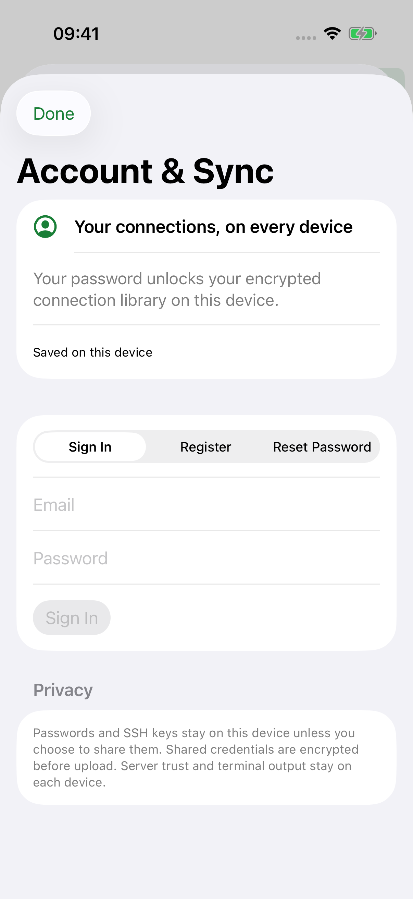
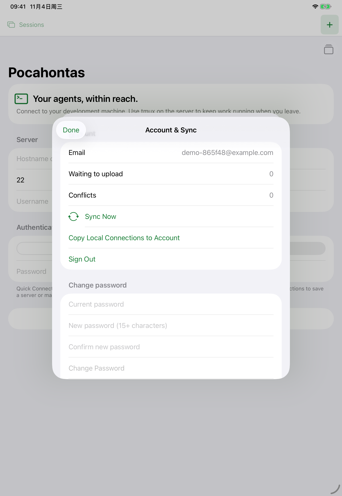
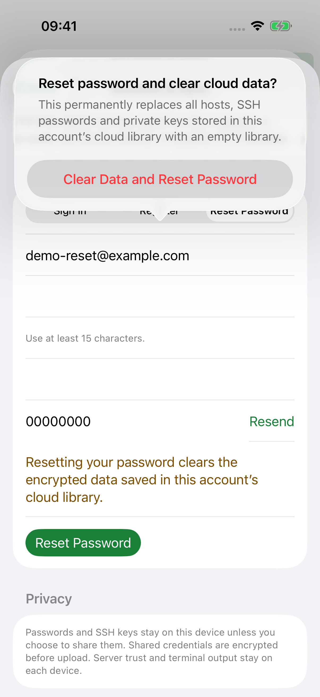

# Account & Sync

2026-11-04。使用一次性 iPhone / iPad 模拟器、真实 App 界面、本机 Node HTTP fixture 和临时 PostgreSQL。设备设为深色，App 和弹窗保持浅色。所有账号、验证码、密码均为测试数据；邮件留在 fixture 内存中，没有投递真实邮件。

每个平台保留 9 张原始 XCTest 截图，覆盖登录、邮箱注册、同步状态、冷启动恢复、密码重置及清空确认；安全输入内容可能被系统截图遮蔽。测试会退出并用已输入的密码重新登录，验证密码输入、Keychain 恢复与退出清理。重置界面测试在确认弹窗取消；真正的清空、重加密和旧编辑保留由 `scripts/test-account.sh` 验证。

| 状态 | iPhone | iPad |
| --- | --- | --- |
| 登录 | [查看](iphone/01-sign-in.png) | [查看](ipad/01-sign-in.png) |
| 填写登录信息 | [查看](iphone/02-sign-in-filled.png) | [查看](ipad/02-sign-in-filled.png) |
| 注册表单 | [查看](iphone/03-register.png) | [查看](ipad/03-register.png) |
| 邮箱验证码 | [查看](iphone/04-register-code.png) | [查看](ipad/04-register-code.png) |
| 已登录与同步 | [查看](iphone/05-account-synced.png) | [查看](ipad/05-account-synced.png) |
| 冷启动恢复 | [查看](iphone/06-account-restored.png) | [查看](ipad/06-account-restored.png) |
| 重置密码 | [查看](iphone/07-reset-password.png) | [查看](ipad/07-reset-password.png) |
| 填写重置信息 | [查看](iphone/08-reset-filled.png) | [查看](ipad/08-reset-filled.png) |
| 清空资料确认 | [查看](iphone/09-reset-confirmation.png) | [查看](ipad/09-reset-confirmation.png) |





## 复现

```sh
npm ci --prefix server
scripts/capture-account-screenshots.sh
# 只运行模拟器
ACCOUNT_TEST_DEVICES='iphone ipad' scripts/capture-account-screenshots.sh
```

系统可能在安全输入框上显示“使用强密码”提示。测试先关闭该系统提示再输入 fixture 密码，不关闭设备的自动填充功能，不替换生产输入控件。原生 Keychain 测试同时校验凭据与登录材料可由新存储实例读取，清除后不能再读取。

Mac 编译和独立 Keychain 测试已通过；Mac XCUITest 在启用系统自动化模式时超时，桌面截图也返回 `could not create image from display`。扩展 Mac 原生套件停在 XCTest 与 Xcode 建立测试会话的阶段，已停止，不能视为通过。因此本目录没有伪造或沿用旧版本的 Mac 截图；需在可用的图形会话中执行 `ACCOUNT_TEST_DEVICES=macos scripts/capture-account-screenshots.sh` 补验。

真实 FC、发信服务、真机和跨网络同步尚待部署联调，参见 [server](../../../server/README.md#运行方式)。
