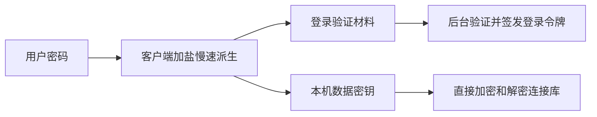

# 一个密码完成登录与解锁

设计状态：2026-11-04，根据产品决定采用；尚未实现。首期不生成、不存储、不展示恢复密钥，也没有独立的解密密码。

## 用户流程

| 场景 | 操作 | 数据结果 |
| --- | --- | --- |
| 注册 | 验证邮箱，设置一个密码 | 创建账号和新的加密连接库。 |
| 新设备登录 | 输入邮箱和密码 | 同一次操作完成服务端认证和本机解密。 |
| 已登录设备 | 使用本机安全存储保护的密钥，可结合系统生物识别解锁 | 不需要重复输入密码，不持久保存密码本身。 |
| 修改密码 | 输入旧密码与新密码 | 用新密码和新盐派生的密钥重新加密整份资料，保留内容，使原登录失效。 |
| 忘记密码 | 验证邮箱，设置新密码，明确确认清空旧资料 | 用新密码和新盐派生的密钥加密空资料，替换旧云端密文。 |

密码重置页使用直接文案：**“重置密码将清空此账号在云端保存的主机、SSH 密码和私钥。此操作无法恢复这些资料。”** 确认按钮为“清空资料并重置密码”。提交时一并携带验证码和明确的清空确认；申请验证码不删除数据，验证码不能用于普通登录。

注册邮箱规范化为 trim 后转小写，不合并点号或 `+` 后缀；首次仅支持常见 ASCII 邮箱。密码按 Unicode NFC 规范化后编码为 UTF-8，不 trim、不折叠大小写；客户端最低 15 个 Unicode code point、最大 1,024 个 UTF-8 字节，支持长口令。不把复杂字符组合要求当作强度保证。服务端不接收原密码，因此无法直接验证其长度/强度；这是官方客户端的输入约束，不宣称为服务端可强制验证的密码策略。

## 设计依据与边界

首期由密码和随机盐派生数据密钥，直接加密整份连接库。用户输入一次密码，客户端内部按用途分别派生登录验证材料和数据密钥；只有登录材料发送给 server。用途隔离采用 [RFC 5869 的 HKDF info](https://www.rfc-editor.org/rfc/rfc5869.html#section-3.2)，加密采用标准 AES-256-GCM。下面的具体格式是 Pocahontas 自己的待验证协议，不声称兼容其他产品或已经过安全审计。

快照上限为 1 MiB，正常改密码需要重新加密、上传整份资料，客户端与 server 都检查其来源快照的更新时间。修改密码和邮箱重置都会更换数据密钥，其他设备旧的未同步编辑不能自动回传，具体处理见下文。



## 密码派生与数据加密

首期 `kdfVersion=1` 固定采用 PBKDF2-HMAC-SHA256、32 字节随机盐、600,000 次迭代、32 字节输出。客户端必须验证算法/次数符合协议，不接受服务端下发的任意低成本参数或超大迭代数。以后调整 KDF 时使用明确版本和客户端能力协商。PBKDF2/HKDF/AES 使用平台标准密码库，Node 使用原生 `node:crypto`；不因本设计增加密码学 npm 依赖。[OWASP 密码存储](https://cheatsheetseries.owasp.org/cheatsheets/Password_Storage_Cheat_Sheet.html)

```text
master = PBKDF2-HMAC-SHA256(UTF8(NFC(password)), salt[32], 600000, 32)
loginSecret = HKDF-SHA256(master, salt, UTF8("pocahontas/login/v1"), 32)
dataKey = HKDF-SHA256(master, salt, UTF8("pocahontas/data/v1"), 32)
```

`loginSecret` 只通过 TLS 发送给后台。server 将规范 Base64URL 解码为 32 字节原始材料，独立生成随机 32 字节盐，再以 PBKDF2-HMAC-SHA256、600,000 次迭代计算 32 字节验证值；计算输入是解码后的原始字节，不是 Base64URL 文本。算法、次数、盐和验证值一起保存在 `app_user.password_hash`，不拆列：

```text
pbkdf2-sha256$600000${saltBase64URL}${hashBase64URL}
```

上式花括号表示占位符，实际记录为四段文本，以三个 `$` 分隔；盐和验证值均使用无填充 Base64URL。只借鉴 [Django 的单字段密码记录结构](https://docs.djangoproject.com/en/5.2/topics/auth/passwords/#how-django-stores-passwords)，此处编码规则由 Pocahontas 定义，不宣称与 Django 格式兼容，也不引入其依赖。

登录时先检查记录恰好四段、算法和次数严格为 `pbkdf2-sha256`/`600000`、盐与验证值均为规范 Base64URL 且解码后各 32 字节，再使用记录中的盐重新计算并用 `timingSafeEqual` 比较原始验证值。缺失或格式异常时不能通过密码验证，不接受记录指定的任意算法或迭代次数。Node 使用原生异步 crypto API，限制同时进行的验证数并在计算前执行持久限流，避免阻塞 FC 事件循环和耗尽 CPU。

`password_hash` 只由 server 生成、读取，不接受客户端直接提交，也不返回客户端或写日志。待验证用户为 NULL；注册完成、修改或重置密码时生成新盐并整体替换该字段。它用于验证登录，不用于解密 SSH 资料；`app_user.salt` 则供客户端从用户密码派生登录材料和 dataKey。数据库、API 和派生公式统一称为 salt；password_hash 内部的服务端盐独立生成，不与 app_user.salt 复用。

服务端无法从 loginSecret 直接推导 dataKey，但 loginSecret 本身可以被冒用登录，必须像密码一样处理：不记录、不回显、不写入客户端持久缓存。它不是 PAKE 或不可重放的挑战证明。弱密码仍可被离线猜测，客户端慢速 KDF 和强口令用于提高攻击成本；不宣称服务器绝无可能猜中弱密码。

dataKey 直接用于 AES-256-GCM 加密 JSON 快照，结果存入 app_user.ciphertext；格式与 AAD 见 [加密快照格式](protocol.md#加密快照格式)。每次新加密使用随机 12 字节 nonce；同一个待发送请求重试时使用原密文。官方客户端提交前本机解密自检，确认资料内容与待提交快照一致。server 只能校验格式与并发条件，无法验证密文与密码是否匹配。

salt 为客户端安全随机生成的 32 字节值，API 使用无填充 Base64URL。注册生成一次，修改或重置密码时重新生成，server 拒绝与当前 salt 相同的新盐。因此即使重置时设置了相同密码，派生密钥也会改变。userId、更新时间与密码变更时间不参与派生或 AAD，客户端无需提前获取账号信息或申请其他编号。账号归属由 server 校验。

仅向客户端返回公开 KDF 参数、salt 与密文，不返回 password_hash 或其中的盐与验证值。master、dataKey 和原密码不上传；原密码与 master 使用完尽力清理，本机安全存储只保留受系统保护的 dataKey 和登录令牌。忘记密码后 server 无法解密原资料。

## 注册、修改、重置

账号、salt、password_hash 与当前整份密文快照放在同一条 `app_user` 记录，详见 [server 设计](README.md)。不使用显式多语句事务、外键、独立密码表、密钥表或历史日志。

申请注册验证码时先创建或复用待验证用户，只有邮箱与 ID，密码和密文相关字段均为 NULL，不能登录或取得登录令牌。正式注册请求携带 codeId、code 和客户端生成的初始密文。server 要求验证码关联此用户，且用户的 password_updated_at 为 NULL；验证并设置验证码 deleted_at 后，一条带用户 ID、未删除、原 updated_at 及 password_updated_at IS NULL 条件的 UPDATE 填齐密码、时间和密文。中途失败则重新申请验证码，不撤销消费；完成注册后正常登录。不发中间票据，也不允许未验证者为该用户预设可用密码。

登录成功后签发包含用户 ID、密码变更时间及到期时间的服务端签名令牌，不保存设备或登录记录。每次受保护请求先验签，再检查用户状态及 password_updated_at；多端登录可同时有效。退出清除本机令牌和解锁密钥，不单独撤销服务端令牌。格式与边界见 [登录令牌与退出](protocol.md#登录令牌与退出)。

正常改密码要求当前登录以及旧 loginSecret。发起操作的客户端暂停该账号的新编辑与普通快照上传，等待已有保存请求结束，再读取最新云端快照及其 updatedAt。使用旧 dataKey 解密，与当前密码状态下已有的本机未同步编辑合并；有冲突先由用户处理。随后生成新 salt，从新密码派生新的登录材料与 dataKey，重新加密完整资料并自检。

提交携带来源快照的 expectedUpdatedAt、expectedPasswordUpdatedAt、旧登录材料、新盐、新登录材料及新密文。server 重新验证旧登录材料，检查两个预期时间对应当前账号，用一条条件 UPDATE 同时替换 salt、password_hash、ciphertext，并推进两个时间，见 [密码修改的条件写入](protocol.md#密码修改的条件写入)。expectedUpdatedAt 必须来自客户端实际解密和合并的那份快照，不能换成 server 接到请求时刚读到的时间。若另一个设备已保存修改，整个操作返回冲突且不修改任何字段；客户端重新拉取、合并并重新加密，不能只替换预期时间重试。

旧签名令牌因密码时间变化全部失效。成功后用新密码登录，只有本次已提交的本机编辑可以确认完成，再恢复资料编辑与同步。响应丢失时先尝试新密码登录并下载资料确认，不盲目重复修改，也不提前删除待确认编辑。整个流程只更新用户一行，不需要多语句事务或中间票据。

邮箱重置请求直接携带 codeId、code、confirmDelete:true、新 salt、新登录材料和加密空快照。客户端从新密码与新 salt 派生 dataKey，加密 `{schemaVersion:1,records:[]}`。server 要求关联用户已完成注册、验证码的 created_at 晚于当前 password_updated_at，且新 salt 与原值不同。验证成功后填写码的 deleted_at，只授予本次重置，不允许读取旧密文。一条条件 UPDATE 校验关联用户、校验验证码时读取的 password_updated_at、updated_at 及未删除状态，同时替换 salt、password_hash、ciphertext，并推进两个时间。server 无法证明密文为空，由官方客户端负责生成并自检空快照。旧数据不留在在线表中，也不建删除日志表。消费后中断或条件冲突且用户未更新时需重新申请验证码，不引入跨表事务。

本机缓存和待上传内容按 userId 隔离，保存其 passwordUpdatedAt。密码时间变化后，其他设备停止旧队列上传，用新密码登录并下载云端资料；普通改密码和邮箱重置都会更换 dataKey，不通过密钥比较猜测操作类型。已同步缓存以新资料替换，未同步编辑单独保留并提示用户手动处理，不能自动合并、重加密或上传到新密码状态。仅允许在同一 passwordUpdatedAt 下自动三方合并，不能给旧请求直接替换新令牌或更新时间。发起普通改密码的设备只确认其已提交快照包含的编辑。清理缓存不能静默丢弃未同步编辑，也不要求保留旧密码。离线副本、已取得的旧密钥和旧密文无法远程保证擦除；备份按保留周期处理，重置不能立即终止离线客户端直连开发机器的 SSH 会话。

## 验收

验证密码与 salt 可直接派生 dataKey 并解密、登录材料与 dataKey 用途隔离、待验证用户不能登录或访问数据、错误密码/验证码、共享次数限制和并发单次消费、注册/重置的状态边界、完成注册/改密码/注销后旧码失效、令牌签名/受众/有效期、多端同时登录、本机退出、改密码/重置/注销后全部旧令牌失效、密码材料不写日志、并发快照冲突、普通改密码后明文保留而密钥和密文改变、并发保存使旧快照改密整体失败、邮箱重置使用新盐加密空资料、验证码消费后的中断与重试、密码状态变化后旧编辑不自动回传且不静默删除。数据库结构检查不等于这些业务行为已实现。
